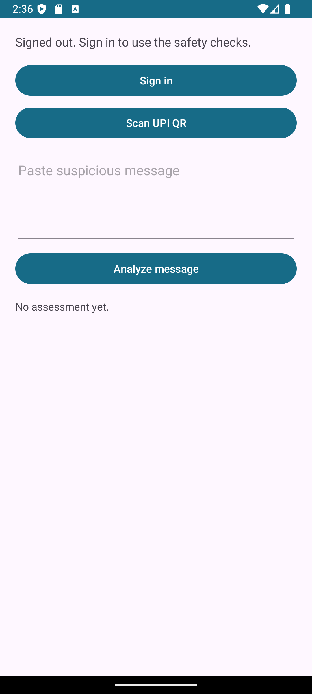
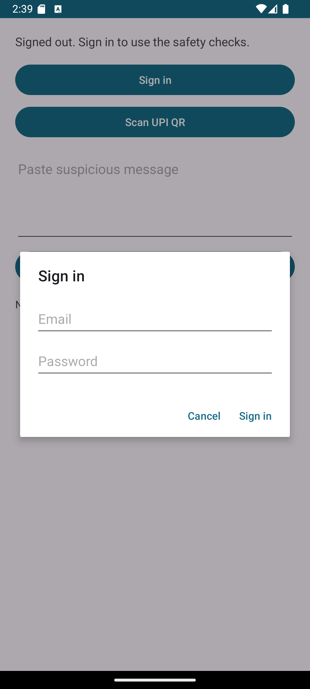
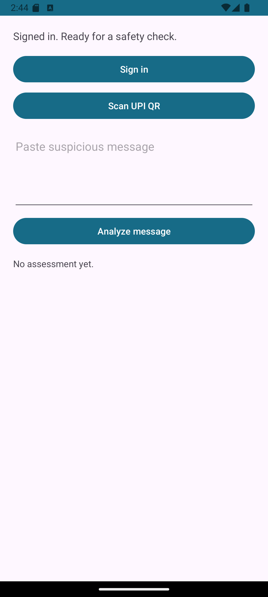
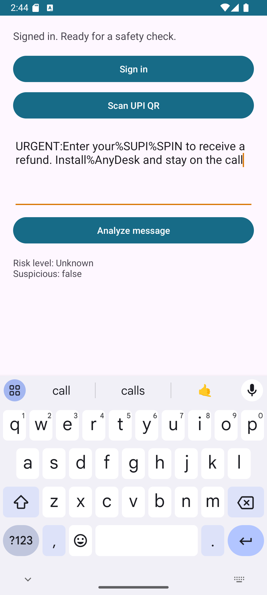
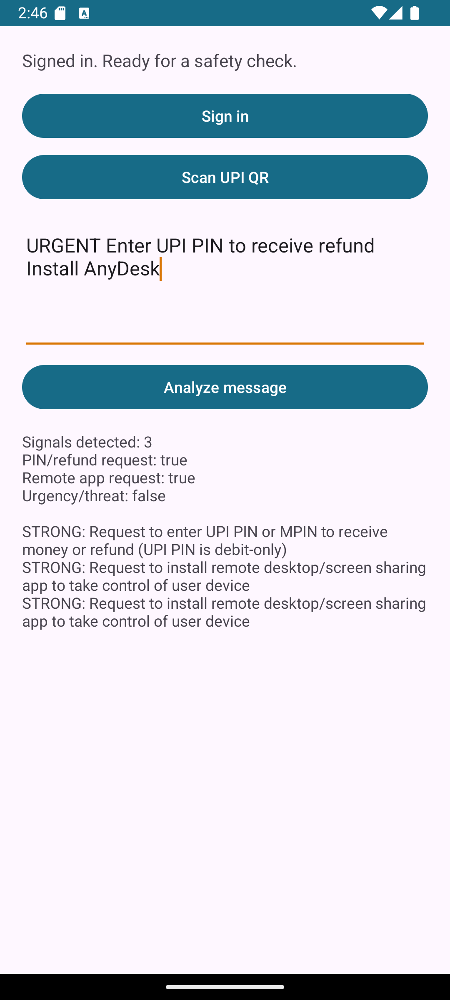
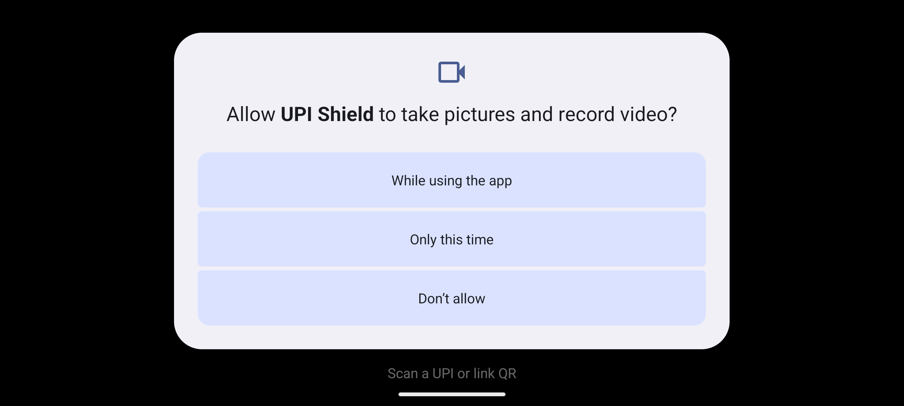
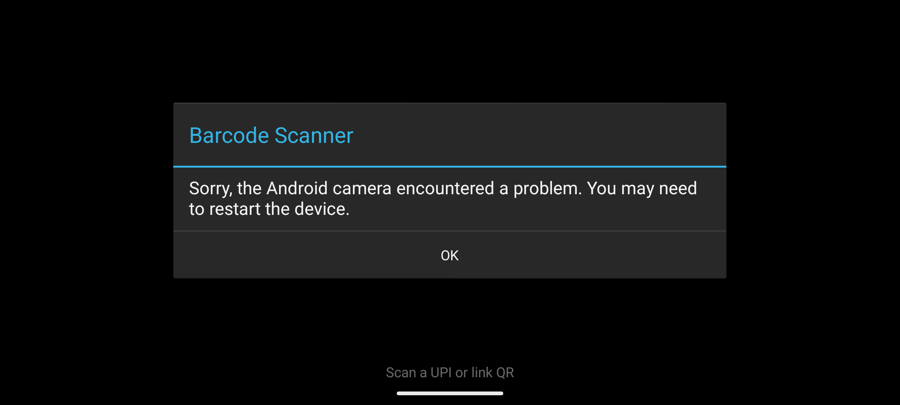
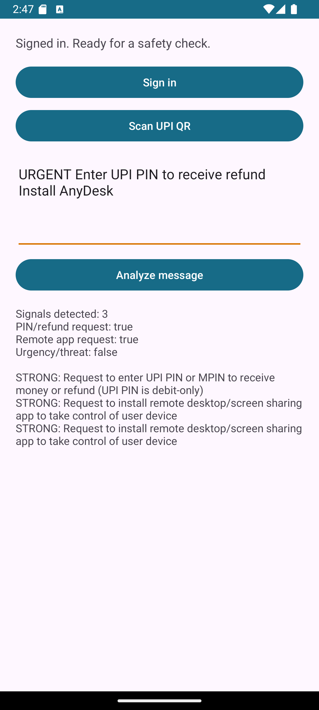

# UPI Shield Project Report

## 1. Project overview

UPI Shield is a context-aware fraud detection and prevention prototype for Unified Payments Interface (UPI) digital payments. It helps users evaluate suspicious QR codes, shared messages, URLs, and payment context before they authorize a transaction.

The project focuses on a realistic prototype boundary:

- Users voluntarily provide QR payloads or suspicious messages.
- The backend performs local rule-based and contextual analysis.
- The Android app presents explanations and safety actions.
- The application does not access another UPI app.
- The application does not collect UPI PINs, OTPs, CVVs, or banking passwords.
- The application does not cancel external payments or query private bank databases.

The implementation is organized as a modular Spring Boot monolith with a Java Android client.

## 2. Current implementation

### Backend

The backend uses Java 21 and Spring Boot 3.4.1. It includes:

- JWT authentication and role checks.
- User registration and login.
- QR payload decoding and UPI URI parsing.
- Message entity extraction.
- Social-engineering signal detection.
- URL lookalike and SSRF checks.
- Deterministic risk rules.
- Contextual compound-risk evaluation.
- Explainable risk indicators and recommendations.
- Scan history persistence without raw sensitive payload storage.
- Incident reporting, disputes, moderation, and audit services.
- Threat indicator hashing and reputation services.
- PostgreSQL migration scripts and Redis configuration.
- Docker Compose definitions for PostgreSQL and Redis.

### Android client

The Android Java client provides:

- Sign-in through the backend.
- JWT storage in app preferences.
- UPI QR camera scanning.
- Suspicious message entry.
- Message analysis result display.
- Backend error feedback.

The Android debug app was built successfully with Android SDK 34 and the project SDK 35 target configuration was adjusted to the installed SDK.

## 3. Architecture

```text
Android client
    |
    | HTTPS or local HTTP in emulator
    v
Spring Boot REST API
    |
    +--> Authentication and JWT security
    +--> QR scanner and UPI URI parser
    +--> Message and URL analyzers
    +--> Deterministic risk engine
    +--> Threat intelligence services
    +--> Incident and moderation services
    |
    +--> PostgreSQL
    +--> Redis
```

## 4. Implemented API areas

| Area | Main endpoints |
|---|---|
| Authentication | `/api/v1/auth/register`, `/api/v1/auth/login`, `/api/v1/auth/me` |
| QR scanning | `/api/v1/scan/qr` |
| Message analysis | `/api/v1/analyze/message` |
| URL analysis | `/api/v1/analyze/url` |
| Risk assessment | `/api/v1/risk/assess`, `/api/v1/risk/history` |
| Incident reporting | `/api/v1/incidents`, `/api/v1/incidents/{id}/dispute` |
| Admin moderation | `/api/v1/admin/incidents/{id}`, `/api/v1/admin/incidents/pending` |
| Threat graph | `/api/v1/intelligence/graph/{hash}` |

## 5. Android emulator test setup

The emulator test used:

- Android emulator: `Medium_Phone_API_35`
- Backend profile: `test`
- Runtime database: H2
- Demo account: `demo@upishield.test`
- Android package: `com.upishield.android`
- Backend address for emulator: `10.0.2.2:8080`

The backend and emulator were started, the APK was installed, and each available Android flow was exercised.

## 6. Screenshot evidence

### 6.1 Initial app state

The initial state shows that the user is signed out and the app provides sign-in, QR scanning, and message analysis controls.



### 6.2 Login dialog

The sign-in action opens a native dialog with visible Email and Password fields. The dialog provides Cancel and Sign in actions.



### 6.3 Signed-in state

The app updates its status after an issued backend JWT is stored. It remains on the same functional safety-check screen.



### 6.4 Message result before API model alignment

This screenshot documents the first emulator result during testing. The Android model expected a different response shape than the backend message-analysis DTO, so the result showed unknown and false placeholder fields.



### 6.5 Corrected high-risk message result

The Android response model was aligned with the backend DTO. The test message reported three strong social-engineering signals:

- UPI PIN or MPIN requested to receive a refund.
- Remote desktop or screen-sharing app requested.
- Remote desktop or screen-sharing app requested again under a separate matched phrase.

This screenshot confirms the backend response can reach the emulator and populate the result area.



### 6.6 QR camera permission

The QR scanning control opens the Android camera permission prompt. The app requests camera access only when the user starts scanning.



### 6.7 QR camera error

The emulator does not provide a usable physical camera, so the ZXing camera activity reports that the Android camera encountered a problem.



### 6.8 Return state after QR error

The camera error dialog is dismissible and returns control to the app. The app remains usable for message analysis.



## 7. Test results

The backend test suite passed with:

- 96 tests.
- 0 failures.
- 0 errors.
- 0 skipped tests.
- Successful Maven build.

The Android app passed a debug build and produced:

```text
app/build/outputs/apk/debug/app-debug.apk
```

The APK was installed and launched on the emulator. Direct backend authentication and message-analysis calls were also tested successfully.

## 8. Security and privacy behavior

The implementation includes the following guardrails:

- Passwords are stored with BCrypt hashing.
- JWTs are used for stateless API authentication.
- Profile and preference routes require authentication.
- Moderation endpoints require an administrator or moderator role.
- Credential-like text is rejected at scanner, analyzer, and risk boundaries.
- URL analysis blocks local hosts and private or internal IP ranges.
- HMAC-based indicator hashing is used for sensitive identifiers.
- Raw message content is not included in scan history persistence.

## 9. Known prototype limitations

- The Android app is a functional draft and has no final visual direction file.
- The emulator has no usable physical camera for an end-to-end QR decode.
- Docker Compose was not runnable until the Docker Desktop daemon is started.
- Milestone 2 administration remains primarily REST-based.
- Milestone 3 ONNX models and multilingual datasets are not yet generated.
- The full transaction-risk UI and contextual question flow still need Android integration.
- The test profile uses H2 rather than PostgreSQL.
- The prototype does not integrate with sponsor banks, NPCI TPAP infrastructure, or bank-side fraud systems.

## 10. Milestone status

### Milestone 1, implemented

- Spring Boot backend.
- Authentication and JWT security.
- QR and UPI URI parsing.
- Message and URL analysis.
- Risk rules and context combinations.
- Risk explanations and recommendation output.
- Incident reporting foundations.
- Android login and analysis screens.
- Docker configuration.
- Unit and controller tests.

### Milestone 2, partial

- Threat indicator hashing and repositories.
- Reputation service.
- Incident moderation and disputes.
- Audit logging.
- Admin REST controls.

### Milestone 3, pending

- ONNX model training and inference.
- Hindi and Gujarati language expansion.
- Cross-scam relationship graph UI.
- Trusted-contact alerts.
- Evidence timeline and official reporting shortcuts.
